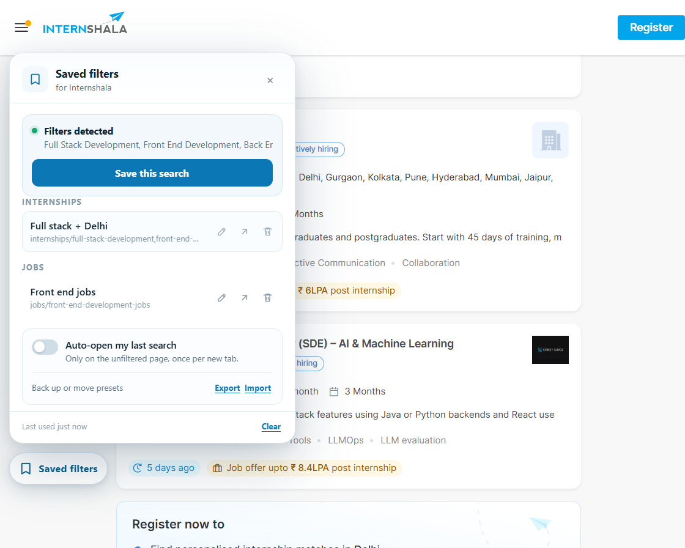

# Internshala Saved Filters

A Chrome extension (and optional Tampermonkey userscript) that remembers your Internshala search filters and restores them in one click.



## The idea

Internshala already puts every filter into the page URL. For example:

```
https://internshala.com/internships/full-stack-development-internship/
https://internshala.com/internships/full-stack-development,front-end-development,back-end-development-internship-in-delhi/
https://internshala.com/jobs/full-stack-development-jobs/
```

So there is no need to automate the dropdowns, checkboxes, or the **Apply** button (which would break every time the site's markup changes). The extension simply saves the filtered URL, gives it a name, and opens it later.

That also means a plain browser bookmark is enough for a no-install solution. The extension adds the quality-of-life parts: a preset list, automatic saving of the last search, rename, backup, and one-click restore.

## What it does

- **Save any filtered search** as a named preset (e.g. "Full stack + Delhi").
- **Rename** a saved search without deleting and recreating it.
- **Export and import** presets as a JSON backup, so they can be moved to another browser or restored later.
- **Remembers your last search automatically** whenever you apply filters.
- Shows a **"Resume last search"** button when you land on the unfiltered internships/jobs page.
- Optional **auto-open last search** in a new tab.
- Works for both **internships** and **jobs**, and groups presets by section.
- Stores everything **locally in your browser**. No account, no server, no network requests.
- Has a small, isolated UI built with Shadow DOM, so Internshala's CSS does not affect it.
- Starts with **no presets**. You add only the searches you actually use.

## Install the Chrome extension

### From the Chrome Web Store

After the extension is approved, the store link will go here:

> **Chrome Web Store:** _add the published URL here_

### Load it manually for testing

1. Download or clone this folder.
2. Open `chrome://extensions` in Chrome.
3. Turn on **Developer mode** (top right).
4. Click **Load unpacked** and select the `chrome-extension/` folder.
5. Open [internshala.com/internships](https://internshala.com/internships), apply filters, and click **Saved filters** in the bottom-left corner.

The extension requests no permissions. Chrome will show a host warning because it adds the panel to Internshala pages; that is expected.

### Build the uploadable zip

```powershell
npm.cmd run package
```

The file is created at `dist/internshala-saved-filters-1.1.1.zip`. The zip has `manifest.json` at its root, ready for the Chrome Web Store.

See [`PUBLISHING.md`](PUBLISHING.md) for the full upload and review checklist.

## Install the Tampermonkey userscript (alternative)

The original userscript is still included for Firefox users or anyone who prefers Tampermonkey.

1. Install [Tampermonkey](https://www.tampermonkey.net/) for Chrome, Edge, or Firefox.
2. Click the Tampermonkey icon → **Create a new script**.
3. Delete the template and paste the contents of [`internshala-filter-saver.user.js`](internshala-filter-saver.user.js).
4. Save with `Ctrl+S` (or `Cmd+S`).
5. Open [internshala.com/internships](https://internshala.com/internships), apply your filters, then click **Saved filters** in the bottom-left corner.

If you host the `.user.js` file somewhere (GitHub Gist raw URL, for example), opening that URL will show Tampermonkey's install screen instead of requiring a copy-paste.

## Usage

### Save a search

1. Apply any combination of filters normally: profile, location, work from home, part-time, stipend, duration, PPO, and so on.
2. Click **Saved filters**.
3. Click **Save this search**.
4. Give it a name (the name is pre-filled from the URL) and click **Save**.

The URL is cleaned before saving: tracking parameters and `page-2`-style pagination are removed, so the preset always starts at the first page.

### Restore a search

- On an unfiltered page, click **Resume last search**.
- Or open **Saved filters** and click any preset.
- If **Auto-open my last search** is enabled, the last search opens automatically once per new tab when you land on the unfiltered page.

### Delete or clear

- Click the trash icon next to a preset to delete it.
- **Clear** in the panel footer forgets the last-used search for the current section.
- Turning off **Auto-open** stops the automatic redirect.

### Rename a saved search

1. Open **Saved filters**.
2. Click the pencil icon next to the preset.
3. Edit the name and press **Save** (or `Enter`). Press **Cancel** or `Esc` to leave it unchanged.

### Back up or move presets

- **Export** downloads a `.json` file containing your presets and last-used searches.
- **Import** reads that file back. Existing searches with the same URL are skipped, so importing twice is safe.
- Import also works with a plain JSON array of presets, in case you build one by hand.

The file is created and read locally. Nothing is uploaded. This is useful when changing browsers or computers, because `localStorage` does not sync between them.

## No-install alternative

If you only need two or three searches, you do not need this extension at all:

1. Apply your filters.
2. Copy the URL from the address bar.
3. Bookmark it with a clear name.

Opening the bookmark restores the filtered search. The extension is essentially a nicer manager for the same trick.

## Why not Python / Selenium?

A Python + Selenium or Playwright script would launch a separate automated browser. That means dealing with login sessions, CAPTCHAs, changing markup, and a slower workflow. For "save my filters and reopen them while I browse", an extension is the right tool because it runs inside your normal, already-logged-in browser.

Python is still a good choice if you later want something different, such as a scheduled job that checks for new internships and emails you. That is a separate project.

## How it works

- Detects whether the current page is an internship search, a job search, or a detail page.
- Reads the current URL and normalizes it:
  - removes `utm_*`, `gclid`, `fbclid`, and similar tracking parameters;
  - removes `page-N` from the path;
  - normalizes the trailing slash.
- Derives a readable name from the URL, e.g.  
  `full-stack-development,front-end-development-internship-in-delhi` →  
  `Full Stack Development, Front End Development in Delhi`.
- Stores presets and the last search in `localStorage` under the key `isf:v1`.
- Exports and imports the same data as JSON, merging presets by their cleaned URL.
- Renders the UI inside a Shadow DOM so page styles cannot leak in.
- Uses the URL as the source of truth. No clicks on Internshala's controls, no fragile selectors.

The Chrome extension's content script is generated from the userscript, so both versions share the same behavior.

## Data and privacy

- All data stays in `localStorage` on `internshala.com`.
- The extension makes no network requests and does not read your account, applications, messages, or credentials.
- The toolbar popup is a static help card with a link to Internshala.
- Clearing the site's cookies/site data removes the saved searches.
- Saved searches do not sync between browsers or devices. Use Export/Import to move them.

The full policy is in [`store/privacy-policy.md`](store/privacy-policy.md).

## Limitations

- Presets are per browser profile.
- Only `https://internshala.com` links are accepted; invalid or non-Internshala links are ignored.
- Imports are capped at 2 MB / 500 presets to keep the panel responsive. Saving new searches is not capped.
- If Internshala changes its URL scheme, older saved URLs may stop working.
- Filters that are stored only in a cookie or in "As per my preferences" may not be represented in the URL, so they may not be captured.
- This is an unofficial helper and is not affiliated with Internshala.
- Tested with the current desktop search page. Internshala changes its UI regularly; the URL-based approach is chosen specifically to survive most of those changes.

## Project structure

| Path | Purpose |
| --- | --- |
| `chrome-extension/` | Manifest V3 Chrome extension |
| `chrome-extension/manifest.json` | Extension manifest |
| `chrome-extension/content.js` | Generated content script (do not edit directly) |
| `chrome-extension/popup.html` | Toolbar popup |
| `internshala-filter-saver.user.js` | Tampermonkey userscript and source of truth |
| `scripts/build-extension.mjs` | Regenerates `content.js` and syncs the version |
| `scripts/generate-assets.ps1` | Regenerates icons and store images |
| `scripts/package-extension.ps1` | Builds the uploadable zip |
| `store/` | Listing copy, privacy policy, screenshot, promo tile |
| `dist/` | Uploadable Chrome Web Store zip |
| `PUBLISHING.md` | Step-by-step store submission guide |
| `preview.png` | Screenshot of the panel |

## Development

Edit `internshala-filter-saver.user.js`; it is the source of truth for the extension.

```powershell
# Rebuild chrome-extension/content.js and sync the manifest version
npm.cmd run build

# Regenerate icons and Chrome Web Store images
npm.cmd run assets

# Build the uploadable zip
npm.cmd run package
```

`chrome-extension/content.js` is generated. Do not edit it directly.

## Publishing

See [`PUBLISHING.md`](PUBLISHING.md). The short version:

1. Test with **Load unpacked**.
2. Upload `dist/internshala-saved-filters-1.1.1.zip` to the Chrome Web Store Developer Dashboard.
3. Use the copy in [`store/listing.md`](store/listing.md).
4. Answer the privacy questions as "no data collected."
5. Submit for review.

The extension name uses "Internshala" descriptively. The listing and popup clearly say it is unofficial. If review objects, rename it to **Saved Filters for Internshala**.
